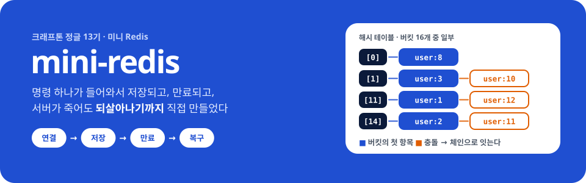
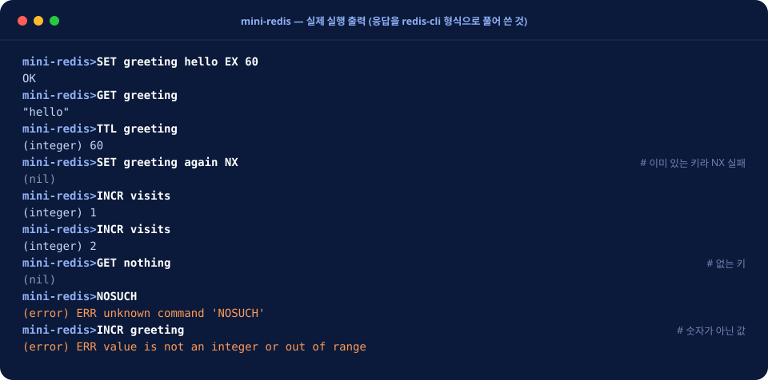
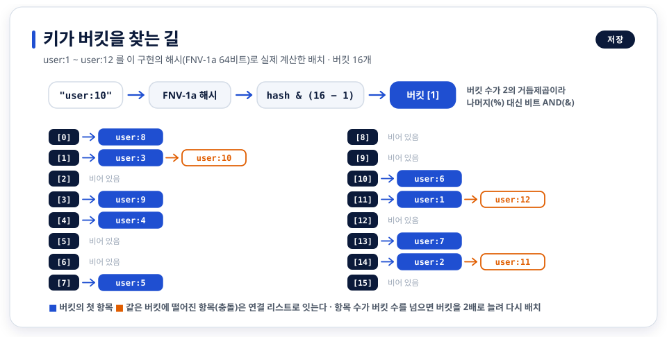
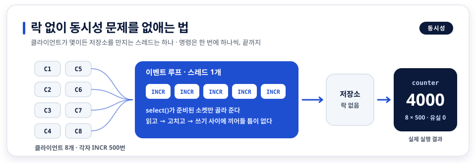
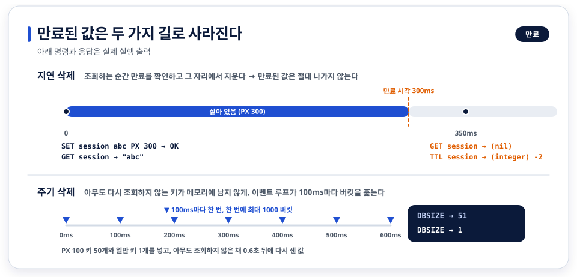
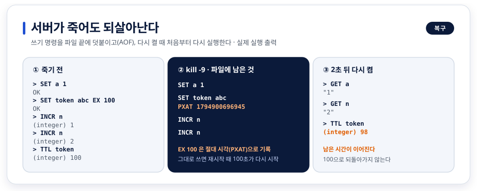
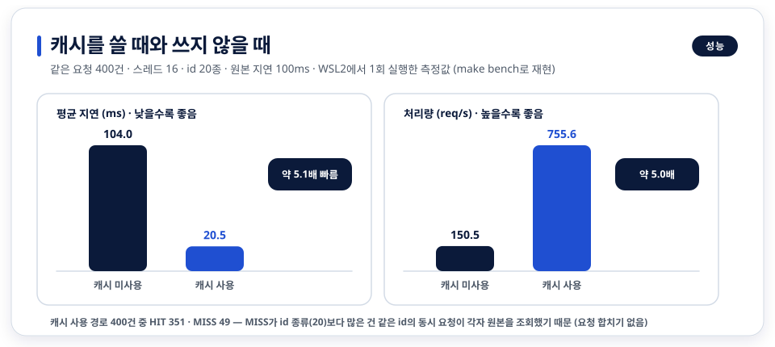

<div align="center">



<br>

**명령 하나가 들어와서 저장되고, 만료되고, 서버가 죽어도 되살아나기까지**

<p>
  
  
  
  
</p>

<sub>크래프톤 정글 13기 · 미니 Redis 구현 과제 · 서버(`src/`)는 C 표준 라이브러리와 POSIX API만 사용</sub>

[빠른 실행](#-빠른-실행) · [1. 연결](#1-연결-명령이-도착하기까지) · [2. 저장](#2-저장-해시-테이블) · [3. 동시성](#3-동시성-락이-없는-이유) · [4. 만료](#4-만료-두-가지-길) · [5. 복구](#5-복구-서버가-죽어도) · [6. 캐시 성능](#6-캐시로-쓰면-얼마나-빨라지나) · [정확성과 범위](#-정확성과-범위) · [더 보기](#-더-보기)

</div>

<br>

## ⚡ 빠른 실행

```bash
make                       # 빌드 (Linux 또는 WSL 의 gcc · make)
./mini-redis --port 6380   # 서버 실행
make test                  # 단위 + 기능 + 데모 API 테스트
make bench                 # 캐시 사용 / 미사용 성능 비교
```


서버는 다섯 부분으로 나뉩니다. **net** 이 소켓을 감시하고, **resp** 가 바이트를 명령으로 읽고, **commands** 가 실행하고, **store** 가 해시 테이블에 담고, **aof** 가 성공한 쓰기를 파일에 남깁니다. 아래는 명령 하나가 이 길을 지나가는 순서입니다.

> **TODO (본인이 작성)**: 이 프로젝트에서 맡은 역할과 직접 한 부분을 한두 문장으로 적는다. (팀 프로젝트라 코드만으로는 알 수 없다)

<br>

## 1. 연결: 명령이 도착하기까지

외부에서 쉽게 쓸 수 있도록 실제 Redis의 프로토콜인 **RESP** 를 그대로 구현했습니다. TCP로 붙어 아래처럼 보내면 됩니다.



`SET greeting hello EX 60` 은 선 위에서 이렇게 생겼습니다. 길이를 앞에 적는 방식이라 값에 공백 · 줄바꿈 · NUL 이 들어 있어도 안전합니다.

```
*5\r\n  $3\r\nSET\r\n  $8\r\ngreeting\r\n  $5\r\nhello\r\n  $2\r\nEX\r\n  $2\r\n60\r\n     →     +OK\r\n
```

**TCP는 스트림입니다.** 명령 하나가 여러 조각으로 나뉘어 오기도 하고, 여러 명령이 한 번에 붙어 오기도 합니다(파이프라이닝). 그래서 연결마다 입력 버퍼를 두고, 파서는 세 가지로만 답합니다.

| 파서의 답 | 뜻 | 서버가 하는 일 |
|:---:|---|---|
| 완성 | 명령 하나를 다 읽었다 | 실행하고, 버퍼에 남은 다음 명령을 이어서 읽는다 |
| 더 필요 | 아직 덜 왔다 | 아무것도 하지 않고 다음 수신을 기다린다 |
| 오류 | 형식이 틀렸다 | `-ERR Protocol error` 를 보내고 연결을 닫는다 |

> **클라이언트가 보낸 길이를 그대로 믿지 않습니다** — `*2000` 이나 `$1000000000` 처럼 길이만 크게 선언하는 입력에 메모리를 내주지 않도록 배열 개수 1024, bulk 16MB, 머리줄 32바이트, 인라인 64KB 로 제한합니다. `telnet` 처럼 한 줄(`SET a 1`)로 보내는 인라인 명령도 받습니다.

<br>

## 2. 저장: 해시 테이블

`SET` 이 실행되면 키는 해시 테이블로 갑니다.



1. **해시** — 키의 바이트를 FNV-1a(64비트)로 섞습니다. 바이트마다 XOR 하고 소수를 곱하는 몇 줄짜리 함수입니다.
2. **버킷 고르기** — 버킷 수를 항상 2의 거듭제곱으로 유지해 `hash & (size - 1)` 로 자리를 정합니다.
3. **충돌은 체인으로** — 같은 버킷에 떨어진 항목은 연결 리스트로 잇습니다(separate chaining). 오픈 어드레싱보다 삭제가 단순합니다.
4. **2배 확장** — 항목 수가 버킷 수를 넘으면(적재율 1 초과) 버킷을 2배로 늘려 전부 다시 배치합니다. 이게 없으면 체인이 길어져 조회가 O(n)에 가까워집니다.

| 함수 (`src/store/store.c`) | 하는 일 |
|---|---|
| `store_set` | 키를 찾아 있으면 값을 바꾸고, 없으면 버킷 맨 앞에 새 항목을 단다. 넣은 뒤 적재율을 보고 `resize` |
| `store_get` | 키를 찾는다. 만료 시각이 지났으면 그 자리에서 지우고 "없음"을 돌려준다 |
| `store_del` | 체인에서 항목을 떼어 내고 해제한다 |
| `resize` | 버킷 배열을 새로 잡아, 저장해 둔 해시값으로 모든 항목을 옮긴다 |
| `store_expire_cycle` | 버킷을 정해진 개수만큼 훑어 만료된 항목을 지운다 (4번 장면) |

키와 값은 길이로 다루므로 binary-safe 이고, 메모리는 저장소가 복사해서 소유합니다.

<br>

## 3. 동시성: 락이 없는 이유



동시에 접근하면 깨지는 지점은 여럿입니다. 두 클라이언트가 같은 값을 읽고 각자 +1 해서 한 번이 사라지는 것, "없다"고 확인한 사이에 다른 쪽이 먼저 쓰는 것, 한쪽이 테이블을 확장하는 중에 다른 쪽이 읽는 것, 한쪽이 지운 항목을 다른 쪽이 아직 들고 있는 것.

락으로 이걸 하나씩 막는 대신 **문제가 생길 자리를 없앴습니다.** 스레드 하나가 `select()` 로 모든 소켓을 감시하다가 준비된 소켓만 처리하고, 명령은 한 번에 하나씩 끝까지 실행합니다. 저장소를 만지는 스레드가 하나뿐이라 위 문제가 모두 성립하지 않습니다.

| 검토한 구조 | 버린 이유 |
|---|---|
| 연결마다 스레드 + 전역 뮤텍스 | 어차피 저장소는 한 번에 하나만 쓰므로 스레드의 이득 없이 락 경합만 생긴다 |
| 버킷별 락 | 확장 때 전부 잠가야 하고, 여러 키를 다루는 명령은 락 순서에 따라 데드락이 난다 |
| 샤드마다 전담 스레드 | 코어를 다 쓰지만 `DEL a b` · `KEYS` 처럼 샤드를 넘는 명령에 조율이 필요하다 |
| **단일 스레드 이벤트 루프** | **선택** — 명령 단위 원자성이 공짜로 따라오고, AOF 기록 순서가 곧 실행 순서다 |

> **이 구조가 보장하지 않는 것** — 원자적인 것은 **명령 하나**입니다. 클라이언트가 `GET` 뒤에 `SET` 하는 사이에는 다른 클라이언트가 끼어들 수 있고, 여러 명령을 묶는 트랜잭션(`MULTI`)은 만들지 않았습니다. 대신 `INCR` · `SET NX` 같은 단일 명령 원자 연산이 있습니다. 또 오래 걸리는 명령(`KEYS`) 하나가 그동안 모두를 막고, CPU 코어를 하나만 씁니다.

<br>

## 4. 만료: 두 가지 길

만료 시각은 "남은 시간"이 아니라 **절대 시각(ms)** 으로 항목마다 저장합니다. 시간이 흘러도 값을 갱신할 필요가 없습니다.



- **지연 삭제만 쓰면** 아무도 다시 조회하지 않는 키가 메모리에 영원히 남습니다.
- **주기 삭제만 쓰면** 주기 사이에 만료된 값이 그대로 반환될 수 있습니다.
- 그래서 **둘 다** 씁니다. 만료된 키는 조회뿐 아니라 덮어쓰기 · 삭제 · `INCR` 에서도 똑같이 "없는 키"입니다.

**무효화: 사용자가 직접 버리기** — 원본이 바뀌었을 때 캐시를 버리는 방법은 세 가지입니다.

| 방식 | 명령 | 성격 |
|---|---|---|
| 시간 기반 | `SET key value EX 60` · `EXPIRE` | 잠깐의 불일치를 허용하는 가장 흔한 방식 |
| 명시적 삭제 | `DEL key` | 원본이 바뀌는 순간 호출. 데모 API의 `DELETE /users/<id>` |
| 일괄 삭제 | `FLUSHALL` · `KEYS user:*` 로 찾아 `DEL` | 한꺼번에 비울 때 |

<br>

## 5. 복구: 서버가 죽어도



쓰기 명령이 성공할 때마다 RESP 형식 그대로 파일 끝에 덧붙이고(**AOF**), 서버를 시작할 때 처음부터 다시 실행합니다. 파서를 그대로 재사용하므로 별도 파일 형식이 없습니다.

1. **상대 시간은 절대 시각으로** — `EX 100` 을 그대로 남기면 재시작 때 100초가 다시 시작됩니다. `SET` 의 `EX` 는 `PXAT` 으로, `EXPIRE` 는 `PEXPIREAT` 으로 바꿔 기록합니다.
2. **성공한 것만** — 실패한 명령, 효과가 없던 명령(`DEL` 이 지운 게 없음), 읽기는 기록하지 않습니다. 이미 통과한 조건(`NX` · `XX`)은 떼고 남깁니다.
3. **잘린 꼬리 복구** — 쓰다가 죽어서 끝이 잘린 명령은 버리고 파일도 그 길이로 자릅니다. 안 그러면 이어 쓰는 기록이 깨진 조각 뒤에 붙습니다. 중간이 깨진 파일은 조용히 넘기지 않고 시작을 거부합니다.

| `--appendfsync` | 디스크에 강제로 쓰는 때 | 잃을 수 있는 것 |
|---|---|---|
| `always` | 명령마다 | 없음에 가깝지만 느리다 |
| `everysec` (기본) | 1초마다 | 전원이 나가면 최대 약 1초분 |
| `no` | OS에 맡김 | OS가 내리기 전의 분량 |

어느 정책이든 매 명령을 OS로는 넘기므로, **서버 프로세스만 죽는 경우**에는 기록이 남습니다(위 그림의 `kill -9`).

> **스냅샷(RDB)을 택하지 않은 이유** — 파일이 작고 복구가 빠르지만 마지막 저장 이후의 데이터를 잃습니다. 실제 Redis는 둘을 함께 씁니다.

<br>

## 6. 캐시로 쓰면 얼마나 빨라지나

느린 원본(100ms 지연으로 DB를 흉내)의 응답을 이 서버에 캐시하는 데모 HTTP API를 만들어 쟀습니다. `/nocache/users/<id>` 는 매번 원본을 조회하고, `/users/<id>` 는 첫 요청만 원본을 조회합니다.



| | 평균 지연 | 중앙값 | p95 | 처리량 |
|---|---|---|---|---|
| 캐시 미사용 | 104.0 ms | 100.8 ms | 106.6 ms | 150.5 req/s |
| 캐시 사용 | **20.5 ms** | **8.8 ms** | 107.1 ms | **755.6 req/s** |

- 캐시를 써도 p95 가 그대로인 건 MISS 가 원본을 기다린 시간이 반영됐기 때문입니다. 캐시는 평균과 중앙값을 낮추지, 가장 느린 요청을 없애지는 않습니다.
- **측정 환경** — WSL2(Ubuntu 22.04)에서 한 번 실행한 값이고 클라이언트와 서버가 같은 머신에 있습니다. 절대값보다 비율을 봐야 합니다.

> **측정하다 찾은 것** — 처음 돌렸을 때는 캐시 적중 응답의 중앙값이 44ms 였습니다. 미니 Redis 의 GET 왕복은 0.08ms 쯤인데 맞지 않았습니다. 캐시 미사용 경로도 똑같이 길었습니다. 데모 서버(파이썬 `http.server`)가 헤더와 본문을 따로 `write` 해서 Nagle 알고리즘과 delayed-ACK 가 겹친 것으로 의심했고, 응답을 한 번에 모아 쓰도록 바꿔 비교해 확인했습니다(적중 중앙값 44ms → 0.4ms 안팎). 고치기 전에는 캐시 효과가 2.4배로 낮게 나왔습니다.

캐시가 죽어도 API는 원본으로 응답하고(`X-Cache: ERROR`), 캐시가 되살아나면 다시 적중합니다.

<br>

## ✅ 정확성과 범위

- **단위 테스트(C)** — 해시 테이블(2배 확장 뒤에도 모든 키가 남는지, NUL 이 든 키, 빈 키와 빈 값, 만료, 주기 삭제의 예산 제한), RESP 파서(**모든 바이트 위치에서 끊긴 입력**, 파이프라인, 바이너리 값, 프로토콜 오류), 명령(옵션 조합, 오류 문구, 시간 경과에 따른 TTL, 오버플로, AOF 재생).
- **기능 테스트** — 실제 서버 프로세스를 띄워 TCP로 외부 사용자처럼 호출합니다. 바이트 단위로 쪼갠 명령, 10만 개 파이프라인과 느린 reader, 4MB 값, 명령을 보내다 끊는 클라이언트, 200개 동시 연결, `kill -9` 뒤 복구, 깨진 AOF 는 시작 거부.
- **데모 API 테스트** — MISS 뒤 HIT, TTL 만료 후 재조회, `DELETE` 로 무효화, 키 주입 시도 거부, 캐시가 죽어도 응답.
- **메모리 검사** — AddressSanitizer · UBSan 빌드로 같은 `make test` 를 돌렸을 때 리포트가 없었습니다(수동 실행, CI 에는 없음).
- **확인하지 못한 것** — `redis-cli` 와 다른 언어의 Redis 클라이언트 접속은 이 환경에서 확인하지 못했습니다. 테스트는 Redis 의 응답 형식에 맞춰 쓴 기대값과 응답 원문을 비교할 뿐입니다.
- **과제 요구사항** — 원문: [docs/requirements.md](docs/requirements.md)

| | 실제 Redis | 이 구현 |
|---|---|---|
| 자료형 | 문자열, 리스트, 해시, 집합 등 | 문자열만 |
| 해시 테이블 확장 | 조금씩 옮기는 점진적 리해시 | 한 번에 전부 옮김 (그 순간 루프가 멈춤) |
| 소켓 감시 | Linux 에서 epoll | `select` (동시 연결 1000개까지) |
| 영속성 | RDB 스냅샷 + AOF (재작성으로 파일 정리) | AOF 만, 재작성 없음 (파일이 계속 커짐) |
| 여러 명령의 원자성 | `MULTI` · Lua 스크립트 | 없음 (단일 명령만 원자적) |
| 보안 | 인증, TLS | 없음 (기본으로 `127.0.0.1` 에만 연다) |

그 밖에 알고 있는 한계는 [docs/known-limits.md](docs/known-limits.md)에 적었습니다. 응답을 읽지 않는 클라이언트의 출력 버퍼에 상한이 없고, AOF 쓰기가 실패해도 클라이언트에는 성공으로 응답하며, 데모 API는 같은 id의 동시 요청을 합치지 않습니다.

> **TODO (본인이 작성)**: 이 과제에서 스스로 세운 목표. AI를 활용한 방식을 밝힐지, 밝힌다면 어디까지 이해하고 설명할 수 있는지.

> **TODO (본인이 작성)**: 위 한계 중 먼저 고친다면 무엇이고 왜인지, 배운 점이나 소감.

<details>
<summary><b>지원 명령</b></summary>
<br>

| 명령 | 인자 | 응답 |
|---|---|---|
| `PING` | `[메시지]` | `+PONG` 또는 메시지(bulk) |
| `ECHO` | `메시지` | bulk |
| `SET` | `key value [NX\|XX] [EX s\|PX ms\|EXAT s\|PXAT ms\|KEEPTTL]` | `+OK`, 조건 불충족 시 nil |
| `GET` | `key` | bulk 또는 nil |
| `DEL` | `key [key …]` | 지운 개수(정수) |
| `EXISTS` | `key [key …]` | 존재하는 개수(정수, 중복 키는 각각 셈) |
| `EXPIRE`, `PEXPIRE` | `key 시간` | 1(설정함) 또는 0(키 없음). 0 이하면 키를 바로 지움 |
| `PEXPIREAT` | `key 절대시각(ms)` | 1 또는 0 |
| `TTL`, `PTTL` | `key` | 남은 초/ms, 만료 없음 -1, 키 없음 -2 |
| `PERSIST` | `key` | 만료를 제거했으면 1, 아니면 0 |
| `INCR`, `DECR` | `key` | 바뀐 값(정수). 없는 키는 0에서 시작 |
| `INCRBY`, `DECRBY` | `key 정수` | 바뀐 값(정수) |
| `KEYS` | `패턴` | 키 배열. 패턴은 `*`, `?`, `[abc]`, `[a-z]`, `[^a]`, `\x` |
| `DBSIZE` | | 키 개수(아직 지워지지 않은 만료 키 포함) |
| `FLUSHALL`, `FLUSHDB` | | `+OK` |
| `QUIT` | | `+OK` 후 연결 종료 |
| `COMMAND` | | 빈 배열 |
</details>

<details>
<summary><b>서버 옵션 · 파이썬 클라이언트 · 데모 API</b></summary>
<br>

| 옵션 | 기본값 | 설명 |
|---|---|---|
| `--port <N>` | 6379 | 기다릴 포트 |
| `--bind <주소>` | 127.0.0.1 | 기다릴 IPv4 주소 |
| `--aof <파일>` | 없음(영속성 끔) | 쓰기 명령을 이 파일에 기록하고 시작할 때 복구 |
| `--appendfsync <정책>` | everysec | `always` / `everysec` / `no` |

```python
import sys; sys.path.insert(0, "demo")
from miniredis_client import MiniRedis

r = MiniRedis("127.0.0.1", 6380)
r.set("greeting", "hello", ex=60)   # 60초 뒤 만료
r.get("greeting")                   # b"hello"
r.ttl("greeting")                   # 남은 초
r.delete("greeting")                # 무효화
```

```bash
./mini-redis --port 6380 &
python3 demo/api_server.py --port 8000 --redis-port 6380
curl -i localhost:8000/users/1          # X-Cache: MISS, 다시 부르면 HIT
curl -i localhost:8000/nocache/users/1  # X-Cache: BYPASS
curl -X DELETE localhost:8000/users/1   # 캐시 무효화
```
</details>

<details>
<summary><b>실행 명령 · 폴더 구성</b></summary>
<br>

```bash
make                     # 빌드
bash .claude/check.sh    # 전체 검사 (경고를 오류로 다룸, CI 와 같음)
make test                # C 단위 테스트 → 기능 테스트 → 데모 API 테스트
make bench               # 성능 비교 (옵션: python3 demo/benchmark.py --help)
```

- 필요한 것: Linux 또는 WSL 의 `gcc` · `make`, 테스트와 데모용 `python3` (표준 라이브러리만 사용)
- 그림(`docs/images/*.svg`)의 명령과 응답, 해시 배치, 수치는 실제 실행 출력과 측정값에서 가져왔습니다.

```
src/
├─ net/       소켓, 단일 스레드 이벤트 루프(select)
├─ resp/      RESP 파서 · 응답 직렬화
├─ commands/  명령 표와 처리
├─ store/     해시 테이블(체이닝) · 만료
└─ aof/       쓰기 명령 기록과 시작 시 복구
tests/        C 단위 테스트(test_*.c) · Python 기능 테스트(*_test.py)
demo/         데모 HTTP API · 파이썬 클라이언트 · 성능 비교
```
</details>

<br>

## 📚 더 보기

| 문서 | 내용 |
|---|---|
| [과제 요구사항](docs/requirements.md) | 요구사항, 중점 포인트, 품질 기준 원문 |
| [알려진 한계](docs/known-limits.md) | 리뷰에서 고치지 않기로 한 지적과 이유 |
